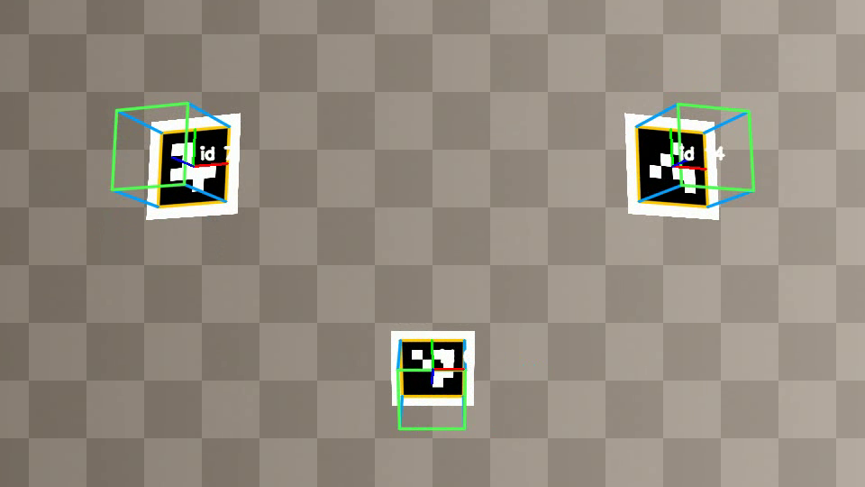
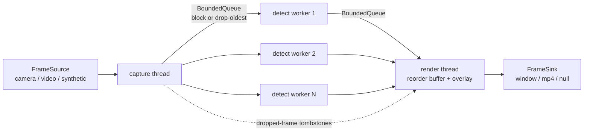

# PoseForge

A real-time **augmented reality (AR) marker tracking pipeline** in modern C++ (C++20) with OpenCV.
PoseForge finds ArUco markers in camera frames, estimates each marker's **6-DoF pose** with
`solvePnP`, and draws a 3D cube anchored on the marker. The work is split into a
**multithreaded capture → detect → render pipeline** with parallel detection workers, bounded
queues and per-stage latency measurement (p50/p95/p99).



## Features
- **Marker detection:** OpenCV `ArucoDetector` (DICT_4X4_50) with sub-pixel corner refinement.
- **Pose estimation:** `solvePnP` with the IPPE-square solver, plus a reprojection error for each marker.
- **AR overlay:** a wireframe cube, coordinate axes and the id, projected through the camera model.
- **Multithreaded pipeline:**
  - 1 capture thread, N detection workers and 1 render thread.
  - Bounded MPMC queues between the stages.
  - A reorder buffer, so output frames stay in capture order.
- **Two overflow policies:** *block* loses no frames (video files, benchmarks); *drop-oldest* keeps latency low (live camera).
- **Failure handling:** an exception in any stage stops every thread cleanly and is rethrown to the caller.
- **Synthetic scenes with ground truth:** markers are rendered at known poses, so tests check accuracy against exact answers, with no camera or dataset download.
- **Benchmark:** compares a sequential baseline against 1…N workers: FPS, speedup and end-to-end latency percentiles. It can be paced like a 30 FPS camera.
- **Calibration loading:** reads OpenCV YAML/XML files (`camera_matrix`, `distortion_coefficients`).
- **Quality checks:** CI builds with `-Wall -Wextra -Wconversion -Werror` and runs the tests under **AddressSanitizer + UBSan** and **ThreadSanitizer**.

## Architecture



Each frame goes through these steps:
1. **Capture** gives it an increasing id.
2. A free **detection worker** (each owns its own `MarkerDetector`) finds markers and estimates their poses.
3. The **render thread** holds out-of-order results in a reorder buffer, then draws the overlay and passes frames to the sink strictly in id order.
4. If the capture queue evicts a frame (drop-oldest), the capture thread sends a *tombstone* for that id, so the reorder buffer doesn't wait for a frame that will never arrive.

Each frame records five timestamps: captured, detect start, detect end, render start and render end. From these the report computes queue wait, detection, render and **end-to-end latency** (captured → overlay drawn).

## Benchmark

`poseforge bench`: 300 frames at 1280×720 with 3 markers, on a 16-thread x86 desktop (WSL2) with OpenCV's internal threads set to 1.

**Throughput** (source unpaced, blocking queues):

| mode | workers | FPS | speedup | detect p50 | e2e p50 | e2e p99 |
|---|---|---|---|---|---|---|
| sequential | 1 | 25.4 | 1.00× | 36.2 ms | 36.7 ms | 54.2 ms |
| pipelined | 2 | 54.7 | 2.16× | 34.9 ms | 126.3 ms | 157.1 ms |
| pipelined | 4 | 101.7 | 4.01× | 36.7 ms | 87.2 ms | 113.6 ms |
| pipelined | 8 | 143.9 | 5.37× | 53.3 ms | 87.7 ms | 132.3 ms |

**Live-camera behaviour** (source paced at 30 FPS, queue capacity 1):

| mode | workers | queues | FPS | e2e p50 | e2e p99 | dropped |
|---|---|---|---|---|---|---|
| pipelined | 1 | block | 27.8 | 104.3 ms | 143.6 ms | 0 |
| pipelined | 1 | drop-oldest | 27.4 | 54.9 ms | 77.7 ms | 24 |
| pipelined | 2 | drop-oldest | 30.0 | 36.0 ms | 57.9 ms | 0 |

What the numbers show:
- **Throughput scales with workers**, but latency doesn't fall with it. When the source runs unpaced, frames wait in full queues. Past 4 workers, each detection gets slower (36 → 53 ms) as threads compete for memory bandwidth and cache.
- **With 1 worker at 30 FPS the pipeline can't keep up**, because detection takes about 35 ms and a frame lasts 33 ms. With blocking queues, latency builds up. Dropping the oldest frame roughly halves the latency, at the cost of skipped frames.
- **The right fix is a second worker:** the pipeline keeps up at 30 FPS with about 36 ms latency and no drops.

Run it yourself:
```bash
./build/poseforge bench                                       # throughput
./build/poseforge bench --fps 30 --queue 1 --drop-frames      # live-camera behaviour
./build/poseforge bench --workers 1,2,4,8 --json bench.json   # machine-readable results
```

## Usage
```bash
# AR overlay on a synthetic scene, written to a video
./build/poseforge run --synthetic 300 --out demo.mp4

# Live webcam: print a marker first, measure its black square in metres
./build/poseforge generate-marker --id 7 --out marker_7.png
./build/poseforge run --camera 0 --marker-length 0.05 --calib my_camera.yml --show

# A recorded video, sequential baseline
./build/poseforge run --video clip.mp4 --mode sequential --out annotated.mp4
```
Without `--calib`, PoseForge assumes an ideal camera with a 60° horizontal field of view.
Detection still works, but distances are approximate.

## Build and test
```bash
sudo apt install cmake ninja-build pkg-config libopencv-dev libgtest-dev   # OpenCV >= 4.7
cmake -S . -B build -G Ninja
cmake --build build
ctest --test-dir build --output-on-failure

# Sanitizers
cmake -S . -B build-asan -G Ninja -DCMAKE_BUILD_TYPE=RelWithDebInfo -DPOSEFORGE_SANITIZER=address
cmake -S . -B build-tsan -G Ninja -DCMAKE_BUILD_TYPE=RelWithDebInfo -DPOSEFORGE_SANITIZER=thread
POSEFORGE_SERIAL_OPENCV=1 ctest --test-dir build-tsan   # see tests/main.cpp
```

The 38 tests cover:
- the camera model and calibration file round-trips
- detection (empty scene, tilted markers, noise, grayscale input)
- pose accuracy against ground truth: under 1% translation error and under 2° rotation error
- the renderer
- latency percentiles
- the queue: FIFO order, drop-oldest, blocking, close semantics, and 4 producers + 4 consumers losing nothing
- the pipeline:
  - it gives the same results as the sequential runner
  - frame order is kept with 4 workers
  - drop accounting
  - the sink can stop the pipeline
  - an exception from the source propagates to the caller

## Project layout
| Path | Purpose |
|---|---|
| `include/poseforge/camera.hpp` | Pinhole camera intrinsics, calibration load/save |
| `include/poseforge/detector.hpp` | ArUco marker detection |
| `include/poseforge/pose.hpp` | `solvePnP` pose estimation, error metrics |
| `include/poseforge/render.hpp` | Cube / axes AR overlay |
| `include/poseforge/synthetic.hpp` | Ground-truth scene renderer |
| `include/poseforge/bounded_queue.hpp` | Bounded MPMC queue with block / drop-oldest |
| `include/poseforge/pipeline.hpp` | Sequential and multithreaded pipelines, timing report |
| `include/poseforge/frame_io.hpp` | Frame sources (camera, video, memory, synthetic, paced) and sinks |
| `include/poseforge/stats.hpp` | Latency percentiles |
| `apps/poseforge.cpp` | CLI: `run`, `bench`, `generate-marker` |

## Roadmap
1. ~~Project scaffold, CMake, gtest, CI~~
2. ~~Synthetic scene generator with ground truth~~
3. ~~ArUco marker detection~~
4. ~~Pose estimation (`solvePnP`, IPPE square) + reprojection error~~
5. ~~AR overlay renderer, calibration loading~~
6. ~~Bounded thread-safe queue + multithreaded pipeline with in-order reassembly~~
7. ~~Latency statistics + `poseforge bench`~~
8. ~~AddressSanitizer / ThreadSanitizer jobs in CI~~
9. Camera calibration command (chessboard / ChArUco)
10. Pose smoothing across frames (Kalman filter) to reduce jitter
11. OpenGL ES renderer for shaded 3D models
12. Android NDK build of the core library

## License
MIT
